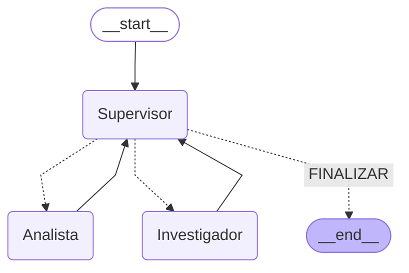

# Pre-entrega 6 -- Orquestador multi-agente especializado

Sistema multi-agente con **LangGraph** en el que un Supervisor coordina
dinámicamente a dos agentes especialistas para investigar y analizar el
sentimiento de noticias de Inteligencia Artificial.

## Dominio elegido

- **Tema:** últimas noticias de IA.
- **Tarea del Investigador:** buscar noticias relacionadas con un tema
  puntual.
- **Tarea del Analista:** evaluar si el sentimiento de esas noticias es
  positivo, neutral o negativo.
- **"Fuentes externas":** una base de datos simulada en memoria (5
  noticias de ejemplo en `agents/research_agent.py`), sin ninguna API de
  búsqueda real (ni Tavily ni similares) -- la consigna permite elegir el
  mecanismo de búsqueda, y esta decisión evita depender de una API externa
  de pago solo para esta pre-entrega.

## Arquitectura: topología jerárquica con Supervisor

```
                 ┌──────────────┐
      ┌────────► │  Supervisor  │ ◄────────┐
      │          └──────┬───────┘          │
      │                 │ decide            │
      │      ┌──────────┴──────────┐        │
      │      ▼                     ▼        │
┌─────┴──────────┐        ┌─────────────────┴┐
│  Investigador   │        │     Analista      │
│ (busca noticias)│        │ (analiza sentim.) │
└─────────────────┘        └───────────────────┘
```

Se eligió una topología **jerárquica** (Supervisor + especialistas) en vez
de, por ejemplo, un pipeline lineal fijo, porque la tarea necesita
**decisiones dinámicas**: cuántas veces investigar, cuándo pasar al
análisis, cuándo refinar y cuándo finalizar no se sabe de antemano -- depende
de lo que se vaya encontrando. Un pipeline fijo (Investigador → Analista →
fin, siempre) no podría manejar el ciclo de refinamiento sin agregar lógica
condicional por fuera, que es exactamente lo que ya ofrece LangGraph con
aristas condicionales. El Supervisor es el único nodo con lógica de
*ruteo*; los especialistas nunca se comunican entre ellos ni deciden por
su cuenta que la tarea terminó -- siempre vuelven al Supervisor.

### Diagrama real del grafo (generado con `graph.get_graph().draw_mermaid()`)



Este diagrama se generó corriendo (podés reproducirlo vos mismo, no hace
falta ninguna API key porque se usa un modelo falso):

```python
from graph import construir_grafo
from tests.fakes import ModeloFalso

async def decisor(state):
    return "FINALIZAR"

g = construir_grafo(modelo=ModeloFalso(responses=[]), decidir_siguiente_paso=decisor)
print(g.get_graph().draw_mermaid())
```

## Estado compartido estructurado

Todo lo que circula entre nodos vive en `AgentState` (`state.py`), que
extiende `MessagesState` de LangGraph y agrega campos propios:

| Campo | Tipo | Quién lo escribe |
|---|---|---|
| `topic` | `str` | Estado inicial |
| `next_agent` | `str` | Supervisor |
| `task_completed` | `bool` | Supervisor |
| `pasos` | `int` | Supervisor (contador) |
| `investigacion` | `Optional[ResultadoInvestigacion]` | Investigador |
| `analisis` | `Optional[ResultadoAnalisis]` | Analista |

`ResultadoInvestigacion` y `ResultadoAnalisis` son modelos **Pydantic**
validados (no texto libre ni diccionarios sueltos): si una herramienta
devolviera, por ejemplo, un `score` fuera del rango 0-1, la validación de
Pydantic lo rechaza (`ValidationError`) antes de que ese dato corrupto se
propague al resto del grafo.

## Especialización de agentes

Cada especialista se construye con `create_react_agent` (el helper de
LangGraph, en vez de armar el ciclo ReAct a mano como en la Pre-entrega 5) y
tiene:

- **Una sola herramienta disponible** (`buscar_noticias_ia` para el
  Investigador, `analizar_sentimiento_noticias` para el Analista) -- no
  pueden desviarse a hacer la tarea del otro.
- **Un prompt que lo limita explícitamente** a su tarea ("no analices el
  sentimiento, esa tarea es de otro agente especialista", etc.).
- **Entrada acotada:** el nodo del grafo le pasa al especialista
  ÚNICAMENTE la instrucción puntual que necesita (el tema a buscar, o la
  lista de noticias a analizar) -- nunca el historial completo de mensajes
  del orquestador.

## Los 2 errores comunes a evitar (resueltos con código, no solo con prompts)

### Contaminación de contexto

Se resuelve en dos frentes:

1. Los especialistas reciben solo una instrucción puntual (ver arriba),
   nunca el historial completo.
2. El Supervisor recibe un **resumen compacto del estado** (función
   `_resumen_estado()` en `graph.py`: tema, paso actual, resumen de la
   investigación y del análisis), no la conversación completa entre
   Investigador y Analista.

### Supervisor infinito

Se resuelve con un contador explícito: el campo `pasos` en el estado y la
constante `MAX_PASOS` (por defecto 6, configurable). Dentro de
`supervisor_node`, si `pasos > max_pasos`, se fuerza `next_agent =
"FINALIZAR"` sin importar lo que diga la función de decisión -- ver el
escenario 3 de la demo, donde un Supervisor deliberadamente "roto" (que
siempre pide más investigación) es cortado por este mecanismo en vez de
colgar el proceso para siempre.

## El ciclo de refinamiento (un verdadero ciclo, no solo una secuencia)

Si el Analista recibe 0 noticias para analizar, marca
`ResultadoAnalisis.suficiente = False`. El Supervisor, al ver eso, vuelve a
mandar al Investigador -- que detecta la situación (mirando
`analisis.suficiente` del estado, NO re-preguntándole al LLM "¿esto fue
suficiente?") y amplía automáticamente el término de búsqueda al genérico
`"ia"` en vez de repetir la misma búsqueda específica que ya sabemos que no
encuentra nada. Además, cuando el Investigador vuelve a correr, limpia el
campo `analisis` del estado (lo pone en `None`): si no lo hiciera, el
Supervisor seguiría viendo el análisis insuficiente *viejo* y mandaría al
Investigador en bucle en vez de pasar al Analista con los resultados
nuevos.

## Por qué el Supervisor no delega TODO en el LLM

En una corrida real (con un LLM de verdad, no el modelo falso de los
tests) el Supervisor llegó a malinterpretar la regla "si ya hay una
investigación pero no hay análisis, mandá al Analista": al ver que la
investigación había encontrado 0 noticias, el LLM razonó que convenía
volver a mandar al Investigador -- en vez de dejar que fuera el Analista
el que marcara el resultado como insuficiente. El síntoma fue que el
grafo se quedaba dando vueltas entre "Supervisor" e "Investigador" hasta
cortar por el contador de pasos, sin llegar nunca a `analisis`.

La solución no fue "ajustar un poco el prompt y cruzar los dedos": de las
3 reglas de ruteo del Supervisor, 2 son completamente deterministas a
partir del estado (no necesitan ningún criterio del LLM, son un simple
`if`) y solo 1 requiere una decisión real. `_construir_decisor_default()`
en `graph.py` resuelve en código esas 2 transiciones sin ambigüedad --
"si no hay investigación, Investigador" y "si hay investigación pero no
análisis, Analista, sin importar cuántas noticias haya encontrado" -- y
deja que el LLM decida únicamente el caso que sí amerita juicio: una vez
que ya hay un análisis, si conviene refinar o finalizar. Esto reduce
además la cantidad de llamadas al LLM (y por lo tanto el costo) sin
perder la parte "inteligente" de la decisión. Hay un test específico
(`test_decisor_default_no_consulta_al_llm_si_falta_analisis` en
`tests/test_graph.py`) que falla a propósito si alguna vez se vuelve a
llamar al LLM para una de estas dos transiciones deterministas.

## Cómo correr el proyecto

```bash
pip install -r requirements.txt
cp .env.example .env   # y completar con tu API key real
```

### Tests automatizados (no necesitan ninguna API key)

```bash
pytest tests/ -v
```

Los 20 tests usan un modelo de chat **falso** (`tests/fakes.py`,
`ModeloFalso`) con respuestas guionadas de antemano, así que corren rápido,
gratis y sin conexión a ningún servicio externo -- cubren las herramientas
de cada agente por separado, las funciones `investigar()`/`analizar()`, y
los 3 escenarios de integración del grafo completo (camino feliz, ciclo de
refinamiento, corte por contador de pasos).

### Demo con un LLM real

```bash
jupyter notebook demo_orquestador.ipynb
```

El notebook corre los mismos 3 escenarios pero con un LLM real tomando las
decisiones del Supervisor (reemplaza al video pedido en la consigna, que no
se puede grabar en este entorno), imprimiendo en vivo qué nodo se ejecuta en
cada paso.

## Checklist de la consigna

- [x] `StateGraph` con un nodo Supervisor que decide dinámicamente a quién
  delegar (aristas condicionales tipadas con `Literal`).
- [x] Al menos 2 agentes especialistas con herramientas y prompts propios,
  acotados a su tarea (`create_react_agent`).
- [x] Estado compartido estructurado con artefactos Pydantic validados.
- [x] Mecanismo real de refinamiento/reintento (no solo un ejemplo feliz).
- [x] Protección explícita contra "Supervisor Infinito" (contador de
  pasos) y contra "Contaminación de Contexto" (entradas acotadas +
  resúmenes de estado).
- [x] Suite de tests automatizados con mocks (sin API keys).
- [x] Notebook de demo de los 3 escenarios (sustituto del video).
- [x] README con diagrama del grafo y justificación de las decisiones de
  diseño.
